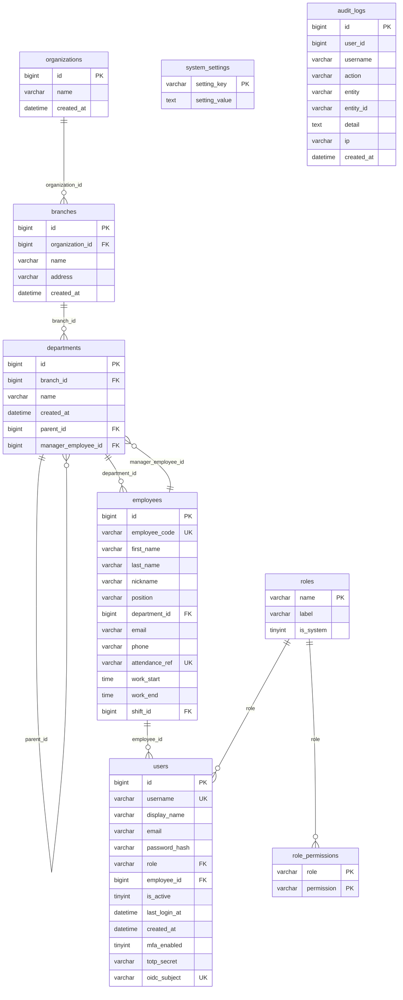
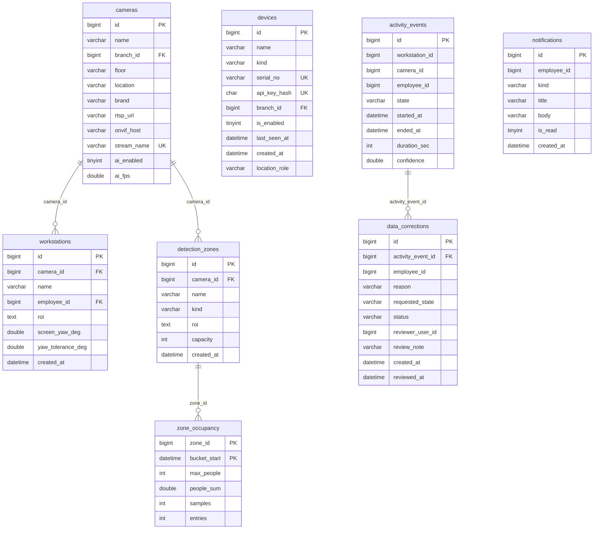
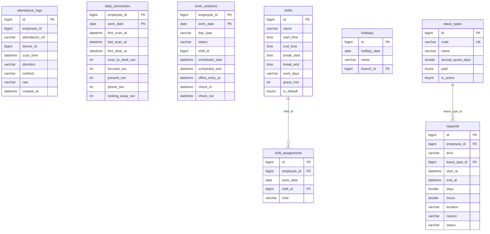
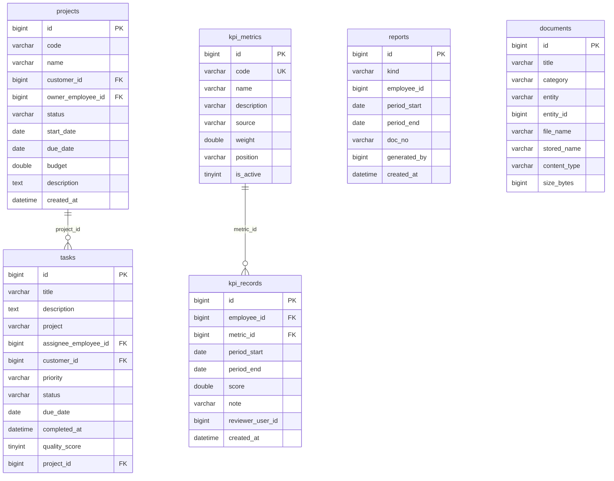
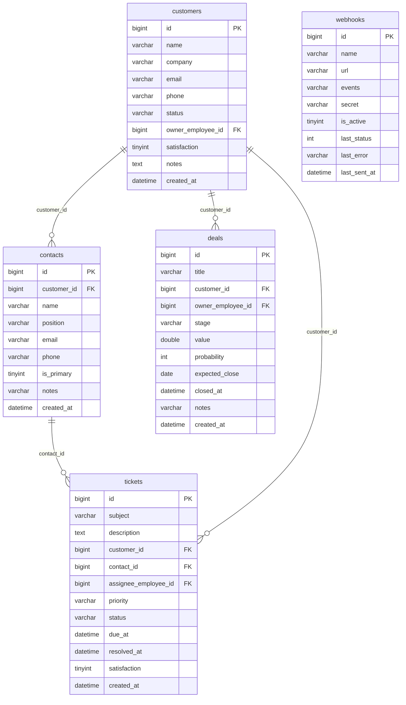

# ER Diagram

สร้างอัตโนมัติจากฐานข้อมูลจริงด้วย `scripts/gen_er_diagram.py` · 36 ตาราง · 35 foreign key

PK = primary key · FK = foreign key · UK = unique · แสดงเฉพาะคีย์และคอลัมน์หลัก (ดูคอลัมน์ทั้งหมดใน `server/migrations/`)

## องค์กรและผู้ใช้

เชื่อมไปโมดูลอื่น:

- `employees.shift_id` → `shifts` (เวลาทำงานและ HR)

## กล้อง AI และอุปกรณ์

เชื่อมไปโมดูลอื่น:

- `cameras.branch_id` → `branches` (องค์กรและผู้ใช้)
- `devices.branch_id` → `branches` (องค์กรและผู้ใช้)
- `workstations.employee_id` → `employees` (องค์กรและผู้ใช้)

## เวลาทำงานและ HR

เชื่อมไปโมดูลอื่น:

- `holidays.branch_id` → `branches` (องค์กรและผู้ใช้)
- `requests.employee_id` → `employees` (องค์กรและผู้ใช้)
- `shift_assignments.employee_id` → `employees` (องค์กรและผู้ใช้)

## งาน KPI และรายงาน

เชื่อมไปโมดูลอื่น:

- `kpi_records.employee_id` → `employees` (องค์กรและผู้ใช้)
- `projects.customer_id` → `customers` (CRM และบริการ)
- `projects.owner_employee_id` → `employees` (องค์กรและผู้ใช้)
- `tasks.assignee_employee_id` → `employees` (องค์กรและผู้ใช้)
- `tasks.customer_id` → `customers` (CRM และบริการ)

## CRM และบริการ

เชื่อมไปโมดูลอื่น:

- `customers.owner_employee_id` → `employees` (องค์กรและผู้ใช้)
- `deals.owner_employee_id` → `employees` (องค์กรและผู้ใช้)
- `tickets.assignee_employee_id` → `employees` (องค์กรและผู้ใช้)
