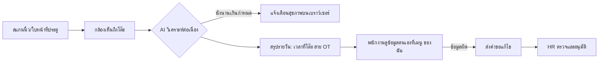
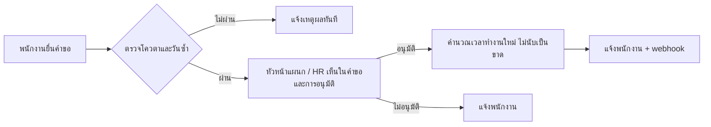
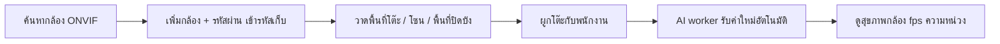
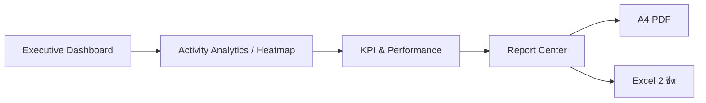

# เอกสารโครงการ: SRS · Feasibility · Technology · User Flow · Hardware · Testing · Deployment · Maintenance · Cost

เอกสารชุดนี้ตอบหัวข้อ "สิ่งที่ต้องดำเนินการก่อนเริ่มพัฒนา" ใน [SPEC.md](SPEC.md#14-สิ่งที่ต้องดำเนินการก่อนเริ่มพัฒนา)
ตัวเลขทรัพยากรทั้งหมดวัดจากระบบที่สร้างแล้วในที่เก็บนี้ ส่วนราคาเป็นการประมาณการเพื่อวางงบเท่านั้น

---

## 1. Software Requirements Specification (SRS)

### 1.1 ขอบเขต

ระบบเว็บสำหรับสำนักงานหนึ่งแห่งหรือหลายสาขา ที่รวม (1) AI วิเคราะห์กิจกรรมจากกล้อง CCTV (2) VMS ดูกล้อง/ย้อนหลัง
(3) เครื่องสแกนเข้างาน (4) HR/เวลาทำงาน (5) งาน โครงการ CRM KPI รายงาน (6) สุขภาพพนักงาน และ (7) ERP
ผู้ใช้: ผู้ดูแลระบบ, ฝ่ายบุคคล, หัวหน้างาน, ผู้บริหาร (ผู้ชม), พนักงาน และบทบาทที่องค์กรสร้างเอง

### 1.2 ความต้องการเชิงหน้าที่ (Functional)

| รหัส | ความต้องการ | สถานะ | ที่อยู่ในระบบ |
|---|---|---|---|
| FR-AI-1 | ตรวจจับ มองหน้าจอ / ใช้โทรศัพท์ / มองทางอื่น / ลุกจากโต๊ะ / ประชุม เป็นช่วงเวลา (วินาที) | ✅ | `ai-worker/detector.py`, `tracker.py` |
| FR-AI-2 | ทำงานเสถียรเมื่อเคลื่อนไหวเร็ว ไม่ค้าง ไม่ดับ | ✅ | Adaptive FPS, FrameGrabber, StateSmoother |
| FR-AI-3 | นับคนในพื้นที่ (โซน) และ heatmap | ✅ | `detection_zones`, `zone_occupancy` |
| FR-AI-4 | พนักงานโต้แย้งผล AI ได้ และมีคนตรวจ | ✅ | `data_corrections` |
| FR-VMS-1 | ดูกล้องสด WebRTC/MSE หลายจอ, PTZ, preset | ✅ | go2rtc + `/video` proxy, ONVIF |
| FR-VMS-2 | ค้นหากล้องอัตโนมัติ (ONVIF WS-Discovery) | ✅ | `/cameras/discover` |
| FR-VMS-3 | ดูย้อนหลังจาก NVR | ✅ | `/cameras/{id}/playback` |
| FR-VMS-4 | ปิดบังพื้นที่ส่วนตัว (privacy mask) | ✅ | วาดบนภาพทั้งฝั่ง server และหน้าเว็บ |
| FR-ATT-1 | รับข้อมูลเครื่องสแกนนิ้ว/ใบหน้า (ZKTeco ADMS, Hikvision, API) | ✅ | `/iclock/*`, `/ingest/attendance` |
| FR-ATT-2 | เวลาสแกน → ถึงโต๊ะ, สาย, ออกก่อน, OT ตามกะ | ✅ | `work_sessions` |
| FR-HR-1 | กะ วันหยุด ลา/ทำงานนอกสถานที่/OT พร้อมอนุมัติตามสายบังคับบัญชา | ✅ | `hr.rs` |
| FR-HR-2 | ผังองค์กร แผนก หลายสาขา | ✅ | `departments.parent_id`, `branches` |
| FR-WORK-1 | งาน โครงการ (Kanban) CRM ลูกค้า ผู้ติดต่อ ดีล Ticket+SLA เอกสาร | ✅ | `business.rs`, `documents.rs` |
| FR-KPI-1 | KPI ถ่วงน้ำหนักจากผลงาน (ไม่ใช้ข้อมูลกล้องคิดคะแนน) | ✅ | `kpi.rs` |
| FR-RPT-1 | รายงาน A4 / PDF, Excel, CSV, ประวัติการออกรายงาน | ✅ | `reports.rs`, `xlsx.rs` |
| FR-WELL-1 | แจ้งเตือนนั่งนาน, พักสายตา, แจ้งเตือนบนเบราว์เซอร์ | ✅ | `ingest.rs`, `app.js` |
| FR-ADM-1 | 22 เมนูแอดมิน, บทบาท/สิทธิ์ 37 รายการ แก้ไขได้ | ✅ | `roles.rs`, `auth.rs` |
| FR-INT-1 | Webhook ลงลายเซ็น HMAC | ✅ | `integrations.rs`, `hooks.rs` |
| FR-SEC-1 | MFA (TOTP), SSO (OIDC), audit log, rate limit, HTTPS | ✅ | `security.rs`, Caddy |
| FR-ERP-1 | เงินเดือน (ประกันสังคม ภาษีหัก ณ ที่จ่าย) + เบิกค่าใช้จ่าย | 🔄 | เฟส ERP |
| FR-ERP-2 | ใบเสนอราคา → ใบแจ้งหนี้/ใบกำกับภาษี → ใบเสร็จ (VAT/หัก ณ ที่จ่าย) | 🔄 | เฟส ERP |
| FR-ERP-3 | จัดซื้อ รับสินค้า สต็อกหลายคลัง | 🔄 | เฟส ERP |
| FR-ERP-4 | บัญชีแยกประเภท (ลงบัญชีอัตโนมัติ) งบทดลอง ทรัพย์สินและค่าเสื่อม | 🔄 | เฟส ERP |

### 1.3 ความต้องการที่ไม่ใช่หน้าที่ (Non-functional)

| รหัส | ข้อกำหนด | เป้าหมาย | ผลที่วัดได้ |
|---|---|---|---|
| NFR-1 | RAM ทั้งระบบ (4 กล้อง) | < 512 MB | ~250-300 MB |
| NFR-2 | API server | < 50 MB | ~10 MB (สูงสุด ~28 MB ขณะโหลดหนัก) |
| NFR-3 | เวลาจากภาพถึงผลตรวจจับ | < 1 วินาที | ~60 ms (YOLOX-Nano, CPU) |
| NFR-4 | การตอบสนอง API ทั่วไป | < 300 ms | 5-40 ms บนข้อมูลทดสอบ |
| NFR-5 | ความเป็นส่วนตัว | ไม่เก็บภาพ/ใบหน้า | เก็บเฉพาะ metadata (สถานะ เวลา ความมั่นใจ) |
| NFR-6 | ความปลอดภัย | OWASP Top 10 | ดู [SECURITY.md](SECURITY.md) |
| NFR-7 | ขยายระบบ | หลายสาขา / หลาย worker | worker แยกเครื่องได้, partition ข้อมูล |
| NFR-8 | ภาษา / เวลา | ไทย, เขตเวลาองค์กร | เก็บ UTC แสดงตาม `TZ_OFFSET_MINUTES` |

### 1.4 ข้อจำกัด

- ผล AI เป็นข้อมูลประกอบ ไม่ใช้ตัดสินผลงานอัตโนมัติ (PDPA, ความเป็นธรรม) ดู [PRIVACY.md](PRIVACY.md)
- ความแม่นยำขึ้นกับมุมกล้อง ต้องทดสอบกับสำนักงานจริงก่อนใช้งาน
- เอกสารภาษี (ใบกำกับภาษี, ภ.ง.ด.) ต้องให้ผู้ทำบัญชีตรวจสอบรูปแบบก่อนใช้งานจริง

---

## 2. Feasibility Study

| ด้าน | ผลการประเมิน |
|---|---|
| **เทคนิค** | เป็นไปได้: ทุกส่วนสร้างและทดสอบแล้ว ใช้โมเดลโอเพนซอร์ส (YOLOX Apache-2.0, YuNet MIT) บน CPU ธรรมดา ไม่ต้องมี GPU |
| **ต้นทุน** | ต่ำ: ไม่มีค่าไลเซนส์ซอฟต์แวร์ ใช้เครื่องเดียว RAM 2-4 GB ได้ถึง ~10-16 กล้อง (ดูหัวข้อ 8) |
| **การปฏิบัติงาน** | ติดตั้งด้วย `docker compose` คำสั่งเดียว, อัปเดตโดยดึงโค้ดใหม่แล้ว build, migration อัตโนมัติ |
| **กฎหมาย (PDPA)** | ทำได้หากแจ้งพนักงาน ขอความยินยอม/อาศัยฐานประโยชน์โดยชอบ จำกัดวัตถุประสงค์ ไม่เก็บภาพ กำหนดระยะเก็บ และให้สิทธิ์โต้แย้ง — ระบบมีกลไกเหล่านี้ |
| **การยอมรับของพนักงาน** | ความเสี่ยงหลักของโครงการ: แนะนำให้สื่อสารว่าใช้เพื่อสุขภาพ/การจัดพื้นที่ ไม่ใช้จับผิด, เปิดให้พนักงานเห็นข้อมูลตนเอง |
| **ระยะเวลา** | MVP → Production ในที่เก็บนี้แบ่งเป็น 8 เฟส + ERP 4 โมดูล ทุกเฟสมีชุดทดสอบ |

ความเสี่ยงและการลดความเสี่ยง:

| ความเสี่ยง | ผลกระทบ | การลดความเสี่ยง |
|---|---|---|
| AI ตรวจผิดในมุมกล้องยาก | ข้อมูลคลาดเคลื่อน | ปรับ ROI/ทิศหน้าจอต่อโต๊ะ, เกณฑ์ความมั่นใจ, ให้พนักงานโต้แย้ง |
| กล้อง/เครือข่ายหลุด | ข้อมูลขาด | ต่อใหม่อัตโนมัติ, ตรวจภาพค้าง, แสดงสุขภาพกล้อง, สถานะ "unknown" ไม่ถูกนับเป็นขาด |
| ข้อมูลรั่วไหล | ร้ายแรง | ไม่เก็บภาพ, เข้ารหัส secret, MFA, HTTPS, สิทธิ์ละเอียด, audit log |
| ข้อมูลโตเร็ว | ช้า | สรุปรายวัน, retention, partition รายเดือน |

---

## 3. Technology Stack Comparison

| ส่วน | ตัวเลือกที่ใช้ | ทางเลือก | เหตุผลที่เลือก |
|---|---|---|---|
| Backend | **Rust (Axum, Tokio)** | Node.js, Go, Python (FastAPI) | RAM ~10 MB, เร็ว, ปลอดภัยด้านหน่วยความจำ, binary เดียว |
| ฐานข้อมูล | **MariaDB / MySQL** | PostgreSQL, TimescaleDB | ตามข้อกำหนด, ปรับ RAM ต่ำได้ (~70 MB), partition รายเดือน |
| AI runtime | **ONNX Runtime + OpenCV** | PyTorch, TensorRT, OpenVINO | ไม่ต้องมี GPU, เล็ก, รองรับ OpenVINO/CUDA เพิ่มภายหลัง |
| ตรวจจับคน/มือถือ | **YOLOX-Nano / Tiny** | YOLOv8/11 (AGPL), MobileNet-SSD | Apache-2.0 ใช้เชิงพาณิชย์ได้, 16 ms/ภาพ บน CPU |
| ทิศทางศีรษะ | **YuNet (5 landmarks)** | MediaPipe FaceMesh, 6DRepNet | เล็ก (~230 KB), MIT, เร็ว |
| Video restream | **go2rtc** | Frigate, Shinobi, ZoneMinder, MediaMTX | เบา, WebRTC/MSE ในเบราว์เซอร์, รองรับ RTSP/ONVIF |
| Frontend | **HTML + ES modules (ไม่ต้อง build)** | React, Vue | ไม่มี dependency, โหลดเร็ว, CSP เข้มงวดได้ |
| HTTPS | **Caddy** | Nginx + certbot, Traefik | ออกใบรับรองอัตโนมัติ, ตั้งค่าน้อย |
| Excel | **เขียนเอง (ZIP + SpreadsheetML)** | rust_xlsxwriter | ไม่เพิ่ม dependency, หน่วยความจำต่ำ |

เปรียบเทียบโมเดล (วัดจริง CPU 4 core ภาพ 960 px ต่อกล้อง): ดู README หัวข้อ "ทรัพยากรที่ใช้"
โอเพนซอร์สที่ศึกษา: [OPEN_SOURCE.md](OPEN_SOURCE.md)

---

## 4. User Flow

### 4.1 พนักงานหนึ่งวัน



### 4.2 ขอลา / ทำงานนอกสถานที่ / OT



### 4.3 ผู้ดูแลติดตั้งกล้องใหม่



### 4.4 ผู้บริหารดูผลและออกรายงาน



---

## 5. Project Folder Structure

```
server/            Rust API (Axum) · migrations/ (SQL) · src/routes/ (โมดูลละไฟล์)
web/               หน้าเว็บ (index.html, css/app.css, js/pages/*.js) ไม่ต้อง build
ai-worker/         Python: อ่านกล้อง ตรวจจับ ติดตาม ส่ง metadata · test_*.py
deploy/            docker-compose.yml, go2rtc.yaml, Caddyfile, mariadb-lowmem.cnf, .env.example
scripts/           seed_demo.py, partition_activity.sql, gen_er_diagram.py
tests/             api_test.py (end-to-end ทุกโมดูล)
docs/              เอกสารทั้งหมด
```

---

## 6. Hardware Requirements & Benchmark

ค่าที่วัด: API ~10 MB · MariaDB ~70 MB · go2rtc 20-40 MB · AI worker ~100 MB + ~15 MB ต่อกล้อง ·
YOLOX-Nano 16 ms/ภาพ (CPU 4 core) · วิเคราะห์ 2 fps ปกติ, 8 fps ขณะมีการเคลื่อนไหว

| ขนาด | กล้อง | CPU | RAM | ดิสก์ | GPU |
|---|---|---|---|---|---|
| เล็ก | 1-4 | 4 core (เช่น Intel N100 / Core i3) | 2 GB (ใช้จริง ~300 MB) | SSD 64 GB | ไม่ต้องใช้ |
| กลาง | 5-16 | 6-8 core (Core i5 / Ryzen 5) | 4 GB | SSD 128-256 GB | ไม่ต้องใช้ |
| ใหญ่ | 17-64 | 8 core + worker แยกเครื่องต่อ 16 กล้อง | 8 GB (server) + 2-4 GB ต่อ worker | SSD 512 GB | ทางเลือก: iGPU OpenVINO / NVIDIA |

การคำนวณ CPU: กล้องละ 2 fps × 16 ms ≈ 3% ของ 1 core ขณะปกติ, ~13% ขณะเร่ง 8 fps
→ 16 กล้องที่เคลื่อนไหวพร้อมกันใช้ประมาณ 2 core · ข้อมูล: ~1-3 MB ต่อพนักงานต่อเดือน (ไม่เก็บวิดีโอ)
วิดีโอบันทึกอยู่ที่ NVR เดิมขององค์กร ระบบนี้เพียงดึงมาดูย้อนหลัง

---

## 7. Testing Strategy

| ระดับ | เครื่องมือ | สิ่งที่ทดสอบ | คำสั่ง |
|---|---|---|---|
| Unit (Rust) | `cargo test` | TOTP (เวกเตอร์ RFC 6238), CRC/ZIP ของ Excel, CSV formula guard | `cd server && cargo test` |
| Unit (AI) | pytest | ติดตามสถานะ, smoother, adaptive fps, freeze, นับคนในโซน | `cd ai-worker && python -m pytest` |
| Integration / E2E API | `tests/api_test.py` | HR, CRM, VMS (mock ONVIF/go2rtc), MFA, SSO (mock OIDC), rate limit, Excel, สาขา | `python3 tests/api_test.py` |
| UI smoke | Playwright | เปิดทุกเมนูตามบทบาท, ไม่มี JS error, ภาพหน้าจอ | ดูตัวอย่างใน README |
| ความเสถียร AI | วิดีโอทดสอบ + สตรีมจริง | เคลื่อนไหวเร็ว ภาพเบลอ สัญญาณหลุด | `ai-worker/test_stability.py` |
| ความปลอดภัย | ตรวจโค้ด + ทดสอบโจมตี | สิทธิ์, IDOR, replay, CSRF ของ SSO, injection | [SECURITY.md](SECURITY.md) |
| ประสิทธิภาพ | วัด RSS / เวลา | RAM ต่อส่วน, ms ต่อภาพ, burst 600 request | README |

หลักการ: ทุกเฟสต้องผ่านชุดทดสอบทั้งหมดซ้ำ 2 รอบติดกัน (ทดสอบซ้ำได้ ไม่ขึ้นกับข้อมูลเดิม) ก่อน commit

---

## 8. Deployment Strategy

1. เตรียมเครื่อง Linux + Docker → `cp deploy/.env.example deploy/.env` แล้วตั้งรหัสผ่าน/คีย์ (`openssl rand -hex 32`)
2. `docker compose up -d --build` (เพิ่ม `--profile https` เมื่อมีโดเมนหรือใช้ใน LAN แบบเข้ารหัส)
3. เข้าสู่ระบบด้วย admin → ตั้งค่าองค์กร → เพิ่มกล้อง/อุปกรณ์ → สร้าง AI Worker key → `--profile ai`
4. นำร่อง 1 แผนก 2-4 สัปดาห์ เทียบผลกับการสังเกตจริง ปรับ ROI/เกณฑ์ แล้วขยาย
5. อัปเดต: `git pull && docker compose up -d --build` (migration ทำงานอัตโนมัติตอนเริ่ม server)
6. ข้อมูลมาก: รัน `scripts/partition_activity.sql` ครั้งเดียว หลังจากนั้น server ดูแล partition เอง

---

## 9. Maintenance & Monitoring Plan

| รอบ | งาน | เครื่องมือในระบบ |
|---|---|---|
| ทุกวัน (อัตโนมัติ) | สรุปรายวัน, ทำเครื่องหมายกล้องออฟไลน์, ลบข้อมูลเกินระยะเก็บ, ดูแล partition | งานเบื้องหลังใน server |
| ทุกวัน | ดูสุขภาพกล้อง (fps, ความหน่วง, ต่อใหม่) และ worker | Camera Management, System Monitoring |
| ทุกสัปดาห์ | ตรวจคำขอแก้ไขข้อมูล AI, คำขอค้างอนุมัติ | Data Corrections, คำขอและการอนุมัติ |
| ทุกเดือน | สำรองฐานข้อมูล (`mariadb-dump`), ทบทวนผู้ใช้/สิทธิ์, ตรวจ audit log | Audit Log, User & Role |
| ทุกไตรมาส | อัปเดต image/แพตช์ความปลอดภัย, ทดสอบกู้คืนข้อมูลจากสำรอง | `docker compose pull` |
| เมื่อเปลี่ยนมุมกล้อง | วาด ROI ใหม่ ตรวจความแม่นยำ | AI Detection Management |

ตัวชี้วัดที่ต้องเฝ้าดู: กล้องออนไลน์ %, fps จริงต่อกล้อง, RAM/CPU ของแต่ละ container, ขนาดฐานข้อมูล,
จำนวน 429 (rate limit) และ login ล้มเหลวใน audit log, คำขอแก้ไขข้อมูลที่เพิ่มผิดปกติ (สัญญาณว่า AI ตรวจผิด)

---

## 10. Cost Estimation (ประมาณการ)

ราคาเป็นช่วงโดยประมาณสำหรับวางงบ (ปี 2569) ควรขอใบเสนอราคาจริงก่อนจัดซื้อ

| รายการ | เล็ก (≤4 กล้อง, ≤20 คน) | กลาง (≤16 กล้อง, ≤80 คน) |
|---|---|---|
| เครื่อง server (mini PC / tower) | 8,000-15,000 บาท | 20,000-35,000 บาท |
| กล้อง IP ONVIF (ถ้ายังไม่มี) | 1,500-3,000 บาท/ตัว | 1,500-3,000 บาท/ตัว |
| เครื่องสแกนนิ้ว/ใบหน้า (ZKTeco/Hikvision) | 3,000-12,000 บาท/เครื่อง | 3,000-12,000 บาท/เครื่อง |
| ไลเซนส์ซอฟต์แวร์ | 0 บาท (โอเพนซอร์สทั้งหมด) | 0 บาท |
| ค่าไฟ (เครื่อง 15-40 W ตลอด 24 ชม.) | ~50-150 บาท/เดือน | ~150-300 บาท/เดือน |
| โดเมน + ใบรับรอง HTTPS | ~400 บาท/ปี (ใบรับรองฟรี) | ~400 บาท/ปี |
| ดูแลระบบ | 1-2 ชม./เดือน | 4-8 ชม./เดือน |

เทียบกับระบบเชิงพาณิชย์ (VMS + HR + Time attendance + ERP แยกกัน) ซึ่งมักคิดค่าบริการรายผู้ใช้/รายกล้องต่อเดือน
ระบบนี้มีต้นทุนหลักเป็นฮาร์ดแวร์ครั้งเดียวและเวลาดูแล

---

## 11. ดัชนีเอกสารตามข้อกำหนด 18 รายการ

| # | เอกสาร | ที่อยู่ |
|---|---|---|
| 1 | SRS | หัวข้อ 1 ของเอกสารนี้ |
| 2 | Feasibility Study | หัวข้อ 2 |
| 3 | Open Source Research | [OPEN_SOURCE.md](OPEN_SOURCE.md) |
| 4 | Technology Stack Comparison | หัวข้อ 3 |
| 5 | System Architecture Diagram | [ARCHITECTURE.md](ARCHITECTURE.md) |
| 6 | Database ER Diagram | [ER_DIAGRAM.md](ER_DIAGRAM.md) (สร้างจากฐานข้อมูลจริง) |
| 7 | API Specification | [API.md](API.md) |
| 8 | UI/UX Design | หน้าเว็บจริงใน `web/` (Day & Night ตามเครื่องผู้ใช้, รองรับมือถือ) |
| 9 | User Flow | หัวข้อ 4 |
| 10 | Project Folder Structure | หัวข้อ 5 |
| 11 | Development Roadmap | [ROADMAP.md](ROADMAP.md) |
| 12 | Hardware Requirements | หัวข้อ 6 |
| 13 | RAM / CPU / GPU Benchmark | หัวข้อ 6 และ README |
| 14 | Security & Privacy Assessment | [SECURITY.md](SECURITY.md), [PRIVACY.md](PRIVACY.md) |
| 15 | Testing Strategy | หัวข้อ 7 |
| 16 | Deployment Strategy | หัวข้อ 8 |
| 17 | Maintenance & Monitoring Plan | หัวข้อ 9 |
| 18 | Cost Estimation | หัวข้อ 10 |
